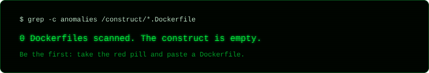

I lead AI at [Kavida.ai](https://kavida.ai). Outside work I port the tools developers rely on to Rust, so they run faster, use less memory and ship as one binary. I also build offline-first apps for the devices at home: no account, no cloud.

### whoami

### Enter the construct

Paste a Dockerfile into an issue. [radolint](https://github.com/DevanshChoubey/radolint) reads it (it never runs it), replies with what it finds within about a minute, and adds your findings to the board below.

  

### Programs running in the construct

- **[shelllint](https://github.com/DevanshChoubey/shelllint)**: ShellCheck in Rust. 6.3× faster on 920 real scripts, up to 20× less memory, plus `--fix`, a language server and a WASM build.
- **[radolint](https://github.com/DevanshChoubey/radolint)**: a drop-in replacement for hadolint. 3.5–6× less CPU, one ~10 MB binary, with a [VS Code extension](https://marketplace.visualstudio.com/items?itemName=DevanshChoubey.radolint) and a GitHub Action.
- **[one-remote](https://github.com/DevanshChoubey/one-remote)**: one offline remote for the TV, ACs, fans and air freshener, over Wi-Fi, IR and Bluetooth.
- **[aer-remote](https://github.com/DevanshChoubey/aer-remote)**: an offline Bluetooth remote for the Godrej aer Smart Matic. Unofficial.

Find me on [X](https://x.com/devanshchoubey_). The card refreshes daily and the board updates with every Dockerfile; both are generated by the workflows in this repo.
