I build AI agents that do real work. Today that means agents that read supplier emails, understand them and keep orders current in the ERP, with every step checked before a human signs off.

### Why

Ever since I watched The Matrix, I've been fascinated by the idea of intelligent machines. As a stupid teenager I didn't know much about programming, or how hard it is to build one. That turned out to be a blessing in disguise: not knowing, I dreamt of making my own Agent Smith to save the world.

I'm still building him, one agent at a time.

### whoami

### Side quests

When I'm not building agents, I make the tools I wish existed:

- **[shelllint](https://github.com/DevanshChoubey/shelllint)**: ShellCheck, rewritten in Rust. 6.3× faster, up to 20× less memory.
- **[radolint](https://github.com/DevanshChoubey/radolint)**: a drop-in replacement for hadolint, in one ~10 MB binary.
- **[one-remote](https://github.com/DevanshChoubey/one-remote)** and **[aer-remote](https://github.com/DevanshChoubey/aer-remote)**: offline remotes for everything at home. No account, no cloud.

> I believe every problem in this world has a solution. All we need is a different perspective and the will of fire.

[devanshchoubey.me](https://devanshchoubey.me) · [LinkedIn](https://www.linkedin.com/in/devansh-choubey-48aa8332) · [X](https://x.com/devanshchoubey_)
