I'm an **AI Architect and Engineering Manager at [QAD](https://www.qad.com)**. I've spent 8 years taking ML and LLM systems to production. Today I architect multi-agent platforms that keep orders current in the ERP, with every step evaluated, traced and costed, and I build the teams that run them.

### whoami

### Systems I've built

- **Multi-agent platform.** I architected Champion, QAD's agents for procurement, sourcing, sales and accounts payable. They run as fault-tolerant workflows in US and EU production for 10+ clients.
- **Multi-model LLM layer.** OpenAI, Claude, Gemini and Bedrock behind one layer, with routing, tracing and per-customer cost control.
- **Evaluation platform.** Golden regression datasets and automatic prompt optimisation that gate every release.
- **Document AI.** 16 trade document types turned into schema-checked data, replacing manual entry. This powers AgentUX at Kavida, which keeps POs, sales orders and quotes current from supplier email.
- **AI-native SDLC.** Spec-driven delivery with governed coding agents across 12 repositories.

### Career, as a trace

### Side quests

On weekends I port developer tools to Rust and build offline apps for the house.

- **[shelllint](https://github.com/DevanshChoubey/shelllint)**: ShellCheck in Rust. 6.3× faster, up to 20× less memory.
- **[radolint](https://github.com/DevanshChoubey/radolint)**: a drop-in replacement for hadolint. One ~10 MB binary.
- **[one-remote](https://github.com/DevanshChoubey/one-remote)** and **[aer-remote](https://github.com/DevanshChoubey/aer-remote)**: offline remotes for the TV, ACs, fans and air freshener. No account, no cloud.

[devanshchoubey.me](https://devanshchoubey.me) · [LinkedIn](https://www.linkedin.com/in/devansh-choubey-48aa8332) · [X](https://x.com/devanshchoubey_) · The trace above is illustrative. The card refreshes daily via the workflows in this repo.
